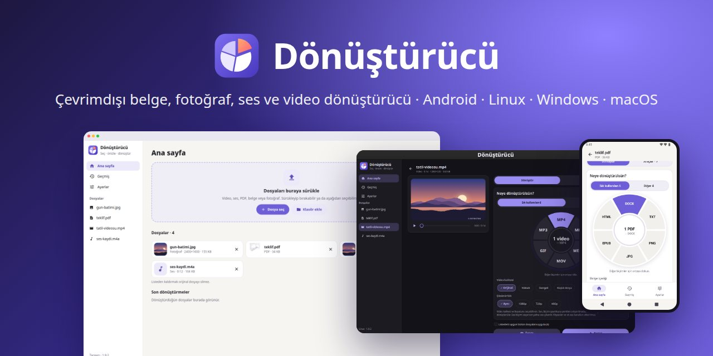
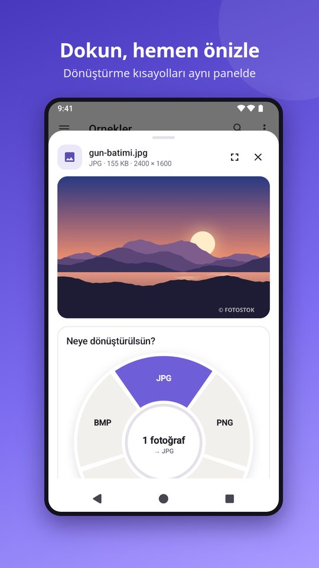
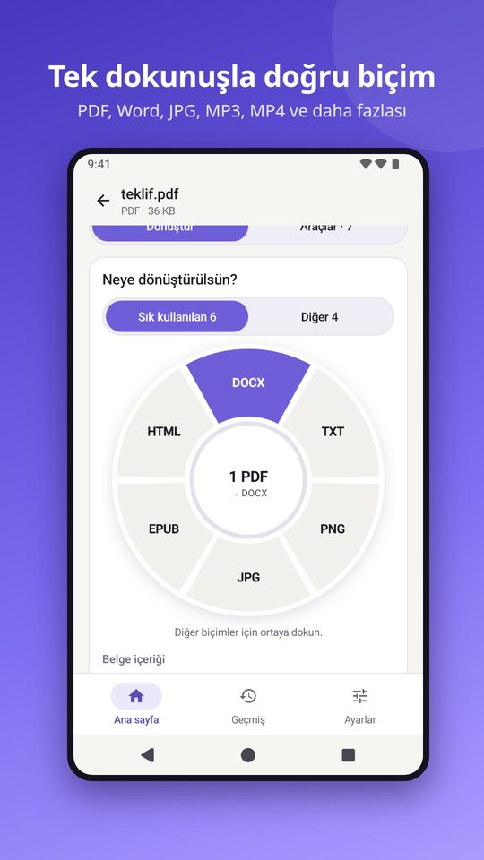
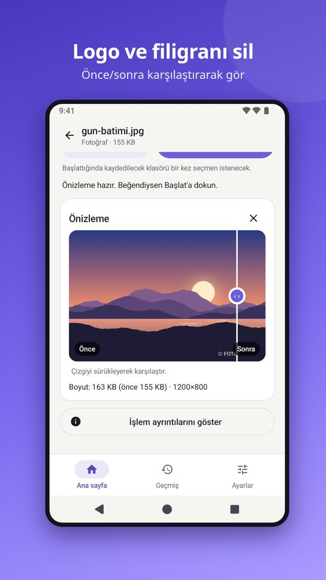
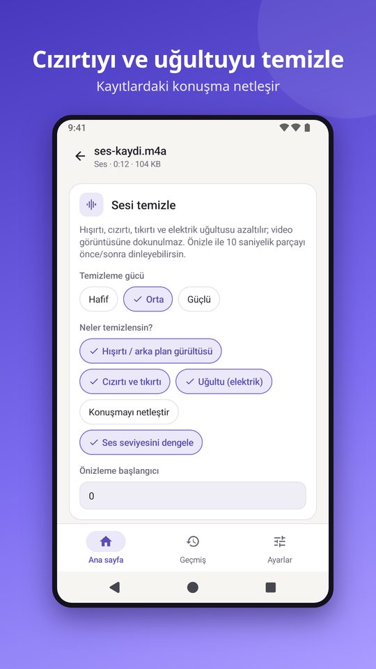
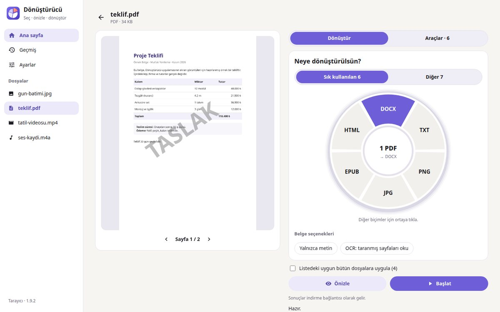
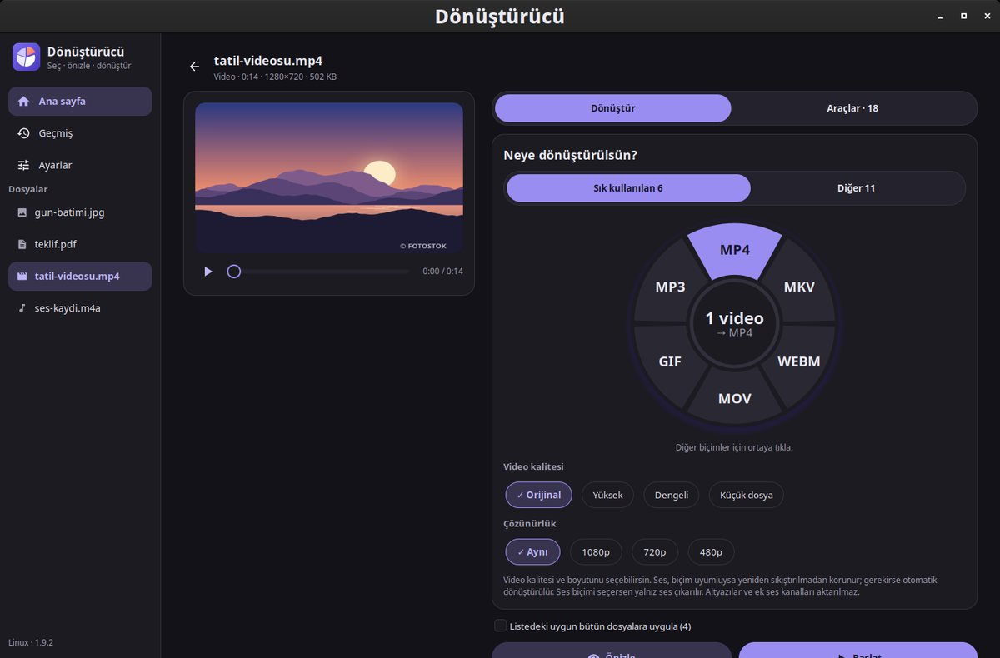
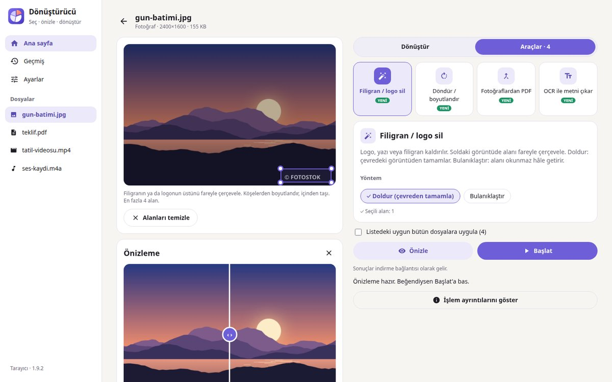
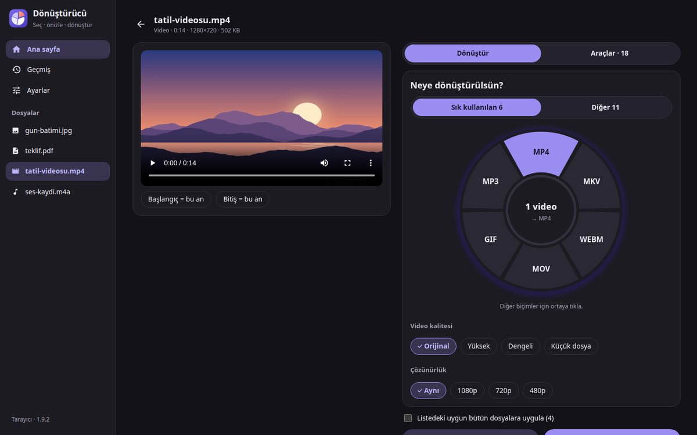

<p align="center"></p>

<p align="center">


</p>

# Dönüştürücü

**Belge, fotoğraf, ses ve video dosyalarını internete yüklemeden dönüştüren, önizleyen ve düzenleyen uygulama.** Android, Linux, Windows ve macOS'ta aynı tasarımla çalışır. Dosyalar yalnızca cihazda işlenir; asıl dosya hiçbir zaman değişmez, her işlem yeni bir kopya üretir.

[English summary below](#english)

## Neler yapar

| | |
| --- | --- |
| 🔄 **Dönüştür** | PDF, Word (DOCX), ODT, RTF, EPUB, HTML, TXT, Markdown, PowerPoint, Excel · JPG, PNG, WEBP, BMP · MP3, WAV, FLAC, M4A, OGG, OPUS, AAC · MP4, MKV, WEBM, MOV, AVI, GIF |
| 👁️ **Önce önizle** | Videoda kısa örnek ve tahmini boyut, seste önce/sonra dinleme, PDF ve fotoğrafta kaydırmalı karşılaştırma |
| 🧽 **Filigran / logo sil** | Video ve fotoğrafta alanı çerçevele, çevresinden doldur ya da bulanıklaştır; PDF'de "TASLAK" gibi damgalar otomatik bulunur |
| 🎧 **Sesi temizle** | Hışırtı, cızırtı, tıkırtı ve elektrik uğultusunu azaltır, konuşmayı netleştirir, ses seviyesini dengeler |
| ✂️ **Video araçları** | Kes, bölüm sil, parçala, birleştir, döndür, hız, sessiz yap, sesi çıkar/ekle/değiştir, fotoğraf al, GIF, altyazı ekle, küçült |
| 📄 **PDF araçları** | Sayfa seç, sil, sırala, döndür, küçült, parçala, birleştir, sayfaları fotoğrafa çevir |
| 📝 **Yazıya dök ve OCR** | Konuşmayı metne ve SRT altyazıya çevirir; taranmış sayfa ve fotoğraflardaki yazıyı okur |
| 📱 **Android'de hızlı önizleme** | Dosyalar uygulamasında dokununca alttan açılan panel: büyük önizleme, biçim seçici ve araç kısayolları |
| 🔒 **Gizlilik** | İnternet bağlantısı kullanmaz, hesap yok, reklam yok, takip yok |

## Ekran görüntüleri

### Android

<p align="center">




</p>

### Masaüstü

| Windows ve macOS | Linux (GTK) |
| --- | --- |
|  |  |
|  |  |

## İndir

| Cihaz | Dosya | Sürüm |
| --- | --- | --- |
| Android 9 ve sonrası (64 bit) | [Google Play](https://play.google.com/store/apps/details?id=com.donusturucu.app) · `Donusturucu-Android-arm64.apk` | 1.4.4 |
| Linux 64 bit (tüm dağıtımlar) | `Donusturucu-Linux-x86_64.AppImage` | 1.9.2 |
| Linux ARM (Raspberry Pi 4/5 vb.) | `Donusturucu-Linux-arm64.AppImage` | 1.9.2 |
| Kali / Debian | `donusturucu-kali-amd64.deb` | 1.9.2 |
| Windows 10 / 11 | `Donusturucu-Windows-x64-Kurulum.exe` | 1.9.2 |
| macOS 13+ (M1–M4) | `Donusturucu-macOS-Apple-Silicon-Kurulum.pkg` | 1.9.2 |

Hazır paketler bu depoda değil, [Releases](../../releases) sayfasında yayımlanır.

**Linux'ta uygulama menüsüne eklemek için:**

```bash
chmod +x Donusturucu-Linux-x86_64.AppImage
./Donusturucu-Linux-x86_64.AppImage --kur
```

Kaldırmak için `~/Applications/Donusturucu.AppImage --kaldir`. FUSE hatası alırsanız Ubuntu 22.04'te `sudo apt install libfuse2`, 24.04 ve sonrasında `sudo apt install libfuse2t64`.

## Gizlilik

Android uygulamasının internet izni yoktur. Linux sürümü kendi penceresiyle çalışır; Windows ve macOS sürümü arayüzünü yalnızca bu bilgisayardan (`127.0.0.1`) erişilebilen, rastgele bir anahtarla korunan yerel bir pencerede açar. Dosyalar hiçbir sunucuya gönderilmez. Ayrıntılar: [Gizlilik politikası](https://helgurt574-cpu.github.io/donusturucu-gizlilik/).

## Kaynaktan derleme

| Klasör | İçerik |
| --- | --- |
| `donusturucu/` | Masaüstü uygulaması (Python). Linux'ta GTK arayüzü `studio.py`; Windows/macOS'ta aynı tasarımın HTML hâli `web/index.html` ve yerel sunucu `webapp.py`; ortak işlem mantığı `jobs.py`, `studio_ops.py` |
| `android/` | Android uygulaması (Java, Gradle'sız). `prepare_inputs.py` model ve kütüphaneleri indirir, `build_apk.py` APK, `build_aab.py` Google Play paketi üretir |
| `packaging/` | AppImage, .deb, Windows (NSIS) ve macOS (.pkg) paketlerini üreten betikler |
| `tests/` | Masaüstü testleri |
| `assets/` | Yazı tipleri, simge ve kendi kendine test dosyaları |

**Masaüstü (Linux, geliştirme):** Python 3, GTK 3 (PyGObject), FFmpeg, Poppler ve `pypdf` gerekir.

```bash
python3 -m donusturucu.studio
```

**Android:**

```bash
cd android
python3 prepare_inputs.py      # SDK dışı bağımlılıklar ve modeller
python3 build_apk.py           # dist/Donusturucu-Android-arm64.apk
python3 build_aab.py           # dist/Donusturucu-arm64.aab (Google Play)
```

İmza anahtarı (`android/signing/`) depoda yoktur; ilk derlemede yenisi oluşturulur. Sürüm notları için [DEGISIKLIKLER.md](DEGISIKLIKLER.md), kullanım için [KULLANIM.txt](KULLANIM.txt).

## Kullanılan açık kaynak bileşenler

[FFmpeg](https://ffmpeg.org) · [Tesseract OCR](https://github.com/tesseract-ocr/tesseract) · [sherpa-onnx](https://github.com/k2-fsa/sherpa-onnx) ve [ONNX Runtime](https://onnxruntime.ai) · [PdfBox-Android](https://github.com/TomRoush/PdfBox-Android) · [pypdf](https://github.com/py-pdf/pypdf) · [Poppler](https://poppler.freedesktop.org) · [Pandoc](https://pandoc.org) · GTK. Her bileşen kendi lisansıyla dağıtılır.

---

<a id="english"></a>
## English

**Dönüştürücü** ("converter" in Turkish) converts, previews and edits documents, photos, audio and video entirely offline on Android, Linux, Windows and macOS. Files never leave the device and originals are never modified.

- Convert between PDF, Word, ODT, EPUB, HTML, TXT, Markdown, images, audio and video formats
- Preview before processing (sample clip, before/after audio, before/after slider)
- Remove watermarks and logos from video, photos and PDF
- Clean hiss, crackle and hum from recordings
- Video and PDF tools, speech-to-text with SRT subtitles, OCR
- Android: tap-to-preview panel from the Files app with one-tap conversion
- The interface is in Turkish and Kurmanji

Download: [Google Play](https://play.google.com/store/apps/details?id=com.donusturucu.app) · desktop packages on the [Releases](../../releases) page.
